<p align="center">
  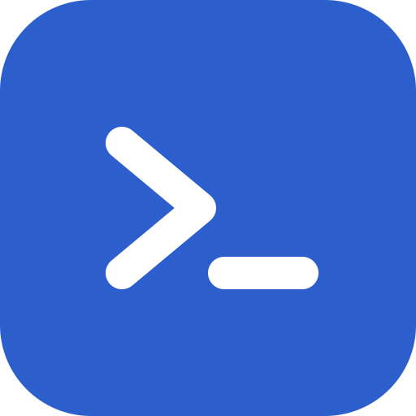
</p>

<h1 align="center">Corral</h1>

<p align="center">
  A self-hosted workbench and SSH gateway for running coding agents (Claude Code, Codex, and more)<br>
  on your own servers — follow, answer, and continue sessions from any desktop, tablet, or phone browser.
</p>

<p align="center">
  <a href="#quick-start">Quick start</a> ·
  <a href="#features">Features</a> ·
  <a href="#documentation">Documentation</a> ·
  <a href="#security">Security</a>
</p>

<p align="center">
  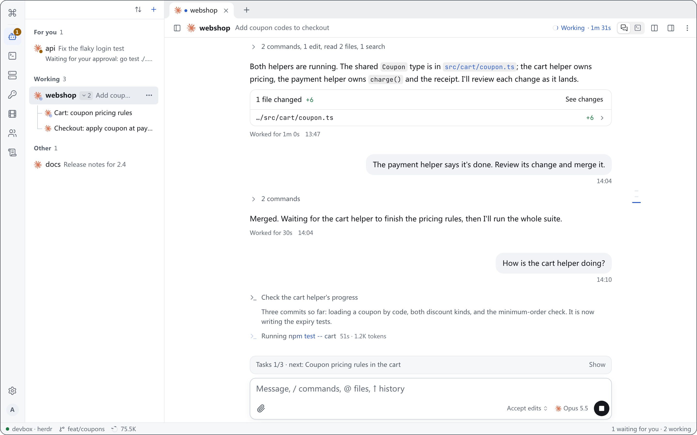
</p>

Corral is a gateway that holds SSH connections and serves both an agent workbench and a full terminal to the browser. Close the laptop, lose signal on your phone, or switch devices: sessions keep running on your hosts and pick up where you left off.

## Features

### Agent workbench

- **Unified agent list and tree** — Collects running agents across your open `herdr` and `tmux` sessions on Linux hosts (supporting Claude Code, Codex, OpenCode, Antigravity CLI, and Devin CLI). Waiting agents surface first, with pinning, filtering, parent–child subagent nesting, and background command tracking.
- **Structured conversations** — Reads each agent's own session log over SSH and renders turns with formatted answers, collapsed tool calls per turn, per-turn file-change summaries and inline diffs, turn navigation, in-thread search, and Markdown export. Supports multiple agent tabs and side-by-side split views.
- **Direct interaction without stealing terminal focus** — Send prompts, queue messages ("send now"), stop a running turn, or answer permission and question cards directly to an agent's pane without switching what `herdr` or another terminal tab displays.
- **Agent composer and actions** — Complete `@` files, `/` commands, and `$` skills; attach images, PDFs, or text files; switch models, reasoning effort, and permission modes; ask side questions (`/btw` on Claude Code); fork or rewind conversations; and launch or resume agents (including git worktrees) from the browser.
- **Session dock** — Inspect git branch, status, diffs against `HEAD` or base branch, pull request status, pane processes, environment variables, task lists, context usage, cost, files, and a live pane terminal alongside the conversation.
- **Desktop workbench and alerts** — Icon rail navigation, command palette (`⌘K`), global status bar showing waiting and working agent counts, optional AI translation/summarization of thinking blocks, and Web Push or webhook alerts with quick-reply actions.

### Terminal and hosts

<p align="center">
  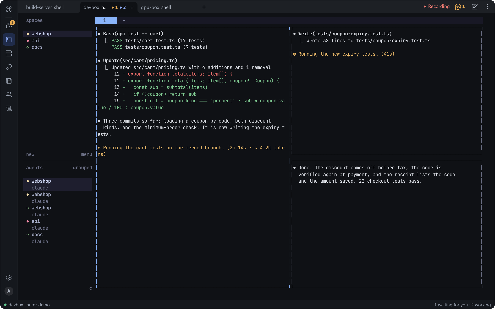
</p>

<p align="center">
  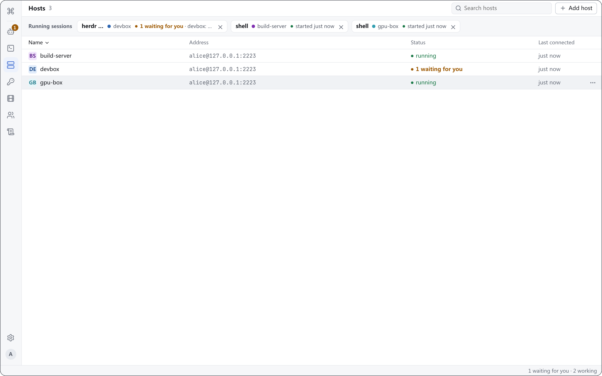
</p>

- **Persistent sessions** — Opening a host lists existing `tmux` and `herdr` sessions (restarting stopped `herdr` sessions on open), offers to start a new one, or falls back to a plain shell. `tmux` and `herdr` sessions survive disconnects and gateway restarts and reattach automatically.
- **Multi-tab terminal** — Keeps up to 8 sessions connected at once for instant switching, with drag-to-reorder tabs, per-device tab positions, and terminal-app keyboard shortcuts when installed as a PWA.
- **Terminal polish** — Light and dark themes with per-mode terminal color schemes and automatic theme sync (mode 2031), copy mode, OSC 52 host clipboard, and hardware-keyboard support (including Option-as-Alt and pasting images to upload).
- **Files, port forwarding, and VS Code** — Built-in SFTP file browser (upload, download, rename, delete, path insertion), drag-and-drop or pasted file uploads, private or shared HTTP port forwarding by clicking localhost addresses, and on-demand VS Code in the browser (`code-server`).
- **Jump hosts and optional host helper** — Single-hop jump hosts with pinned host keys, plus an optional user-consented host helper daemon (`corrald`) over SSH-forwarded Unix sockets for immediate agent updates and lower SSH channel usage.

### Phone and tablet

<p align="center">
  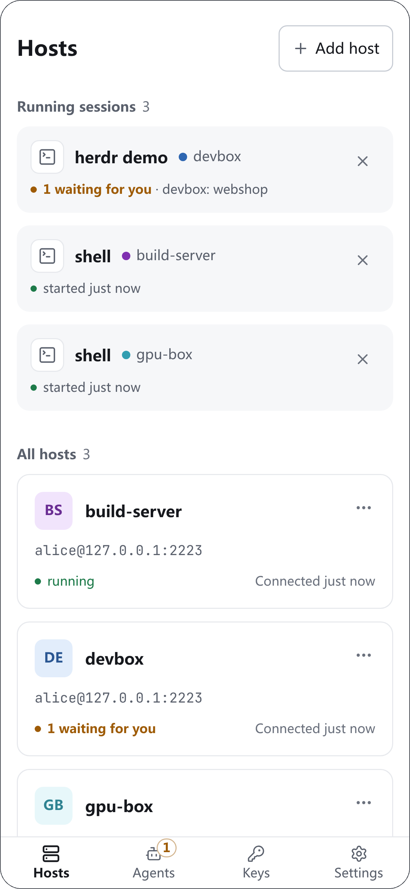
  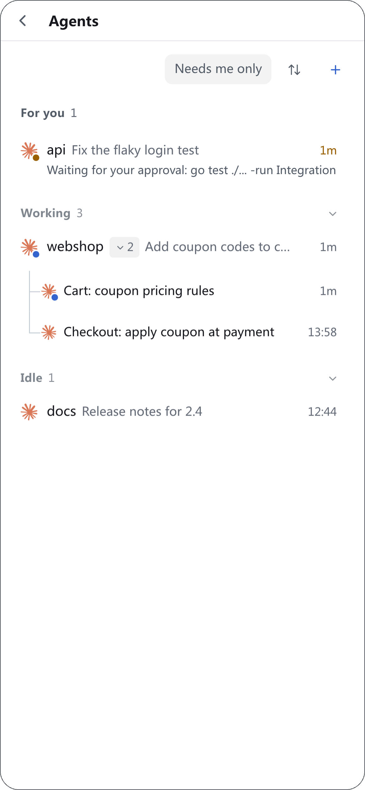
  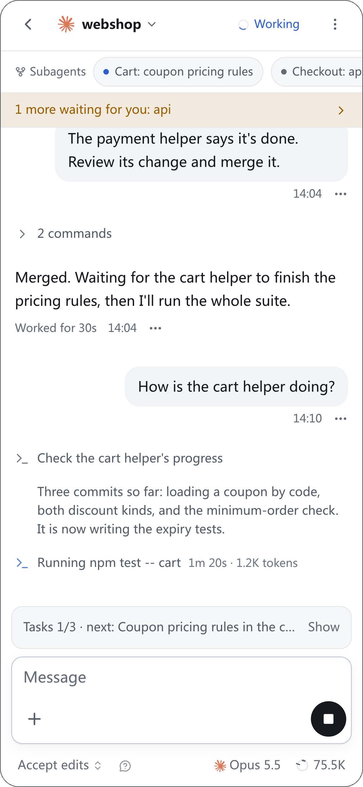
</p>

<p align="center">
  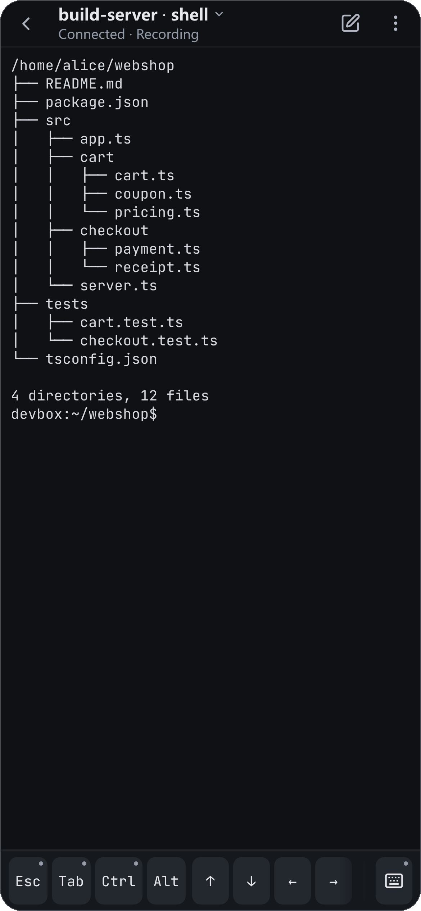
  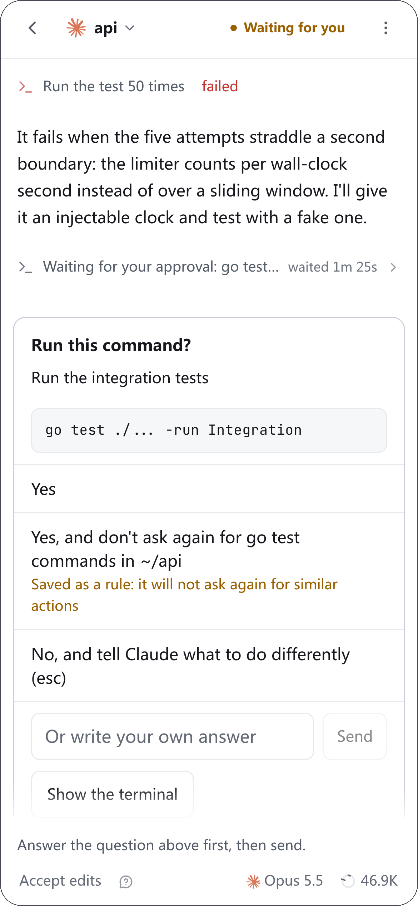
</p>

- **Mobile-first agent and host views** — Dedicated bottom navigation for Hosts, Agents, Keys, and Settings, with full conversation reading, file-change lists, reply sheets, and notification deep-links straight to the waiting agent (Add to Home Screen on iOS and iPadOS for Web Push).
- **Touch terminal and key bar** — Tap where you type to summon the soft keyboard with full Chinese/IME and dictation support. Arrange a customizable key bar (Esc, Ctrl, Alt, Tab, arrows, F1–F12, custom macro sequences, long-press actions, and a Ctrl long-press shortcut panel).
- **Gestures and synced preferences** — Two-finger horizontal swipe switches sessions, vertical swipe switches `herdr` workspaces, pinch resizes the font, and themes, key bars, and preferences sync with your account across devices.

### Team and administration

<p align="center">
  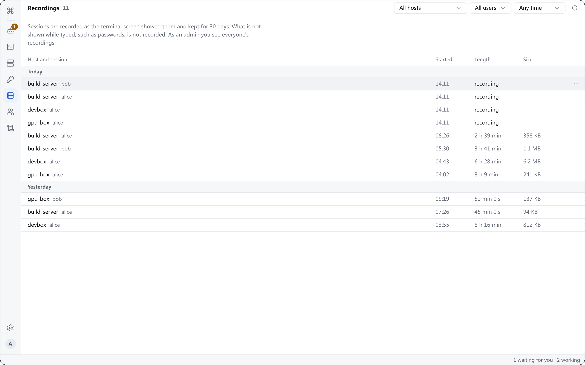
</p>

<p align="center">
  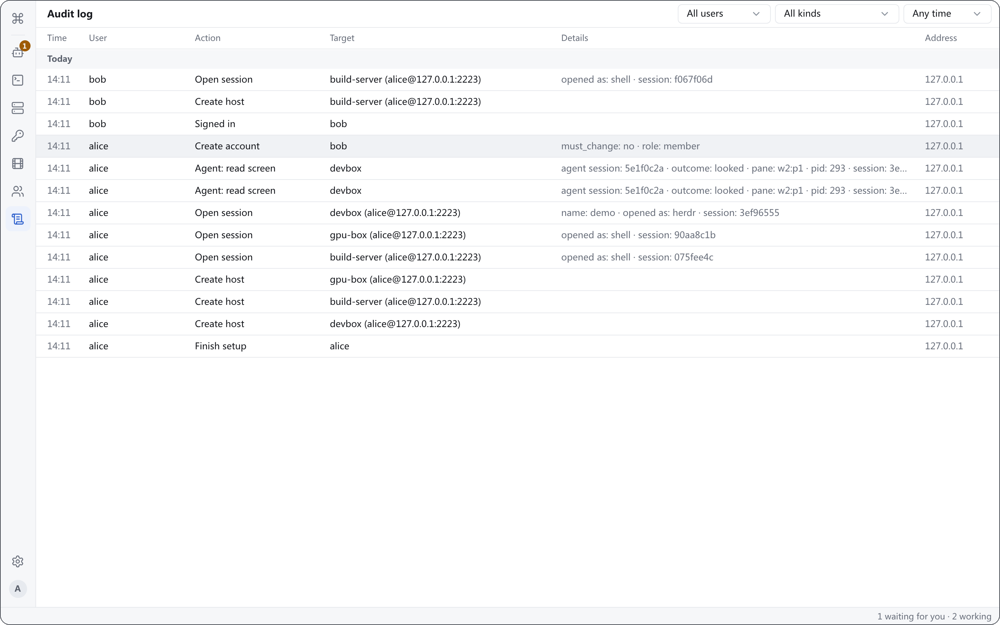
</p>

- **Accounts and SSO** — Invite users by link or create accounts directly as an administrator; each user has isolated hosts and SSH keys. Supports two-step sign-in (TOTP with recovery codes) and OpenID Connect single sign-on with group-based access and admin roles.
- **Recordings and live watching** — Optional asciicast session recording with in-browser playback and configurable retention/size limits, plus read-only live session sharing with chosen teammates.
- **Audit log** — Filterable log of sign-ins, host changes, file uploads, agent interactions, recording views, and session restores.
- **Subscription quota overview** — Displays cached 5-hour and weekly quota windows collected across your hosts for Claude Code, Codex, and Antigravity accounts, with opt-in rate-limited refresh.
- **Bilingual interface** — Ships with English and Chinese interfaces.

## Quick start

Corral runs as a single container (`ghcr.io/ihainan/corral`, `linux/amd64` and `linux/arm64`) or standalone Linux binary from [GitHub Releases](https://github.com/ihainan/corral/releases), with the web UI embedded and data stored in SQLite.

```sh
(umask 077; docker run --rm ghcr.io/ihainan/corral genkey > corral.key)   # keep separate from DB backups
docker run -d --name corral --stop-timeout 30 \
  -p 127.0.0.1:8080:8080 -v corral-data:/data \
  -e CORRAL_PUBLIC_URL=https://ssh.example.com \
  -e CORRAL_MASTER_KEY="$(cat corral.key)" \
  ghcr.io/ihainan/corral
docker logs corral   # prints the one-time link to create the first administrator
```

With Docker Compose (generate `.env` once with `(umask 077; echo "CORRAL_MASTER_KEY=$(docker run --rm ghcr.io/ihainan/corral genkey)" > .env)`):

```yaml
services:
  corral:
    image: ghcr.io/ihainan/corral:latest
    restart: unless-stopped
    stop_grace_period: 30s
    ports: ["127.0.0.1:8080:8080"]
    environment:
      CORRAL_PUBLIC_URL: https://ssh.example.com
      CORRAL_MASTER_KEY: ${CORRAL_MASTER_KEY:?}
      CORRAL_TRUSTED_PROXIES: 172.16.0.0/12
    volumes:
      - corral-data:/data
volumes:
  corral-data:
```

Place Corral behind an HTTPS reverse proxy that passes WebSocket upgrades and disables response buffering (see [`deploy/nginx.conf.example`](deploy/nginx.conf.example)). For reverse proxy setup, forwarded ports, VS Code, host preparation, and building from source, see [Deployment](docs/deployment.md).

## Documentation

- [Deployment](docs/deployment.md) — Docker, Docker Compose, reverse proxy, forwarded ports, VS Code, target hosts, and restarts.
- [Configuration](docs/configuration.md) — Complete reference of all `CORRAL_*` environment variables, defaults, and limits.
- [Single sign-on](docs/single-sign-on.md) — OpenID Connect setup, account linking, group mapping, back-channel logout, and a Keycloak example.
- [Security](docs/security.md) — Trust model, credential encryption, network controls, `corrald` guarantees, and known limitations.
- [Development](docs/development.md) — Local test environment, build targets, and test suites.

## Security

Stored SSH credentials are encrypted at rest with `CORRAL_MASTER_KEY`, which should be kept separate from database backups. On a shared gateway, restrict reachable SSH targets with `CORRAL_ALLOWED_NETWORKS` and review the trust boundaries and known limitations in [docs/security.md](docs/security.md). Report vulnerabilities privately as described in [SECURITY.md](SECURITY.md).

## License

[Apache-2.0](LICENSE)
