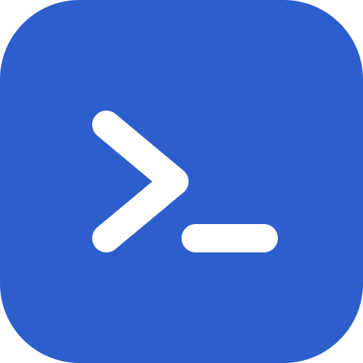
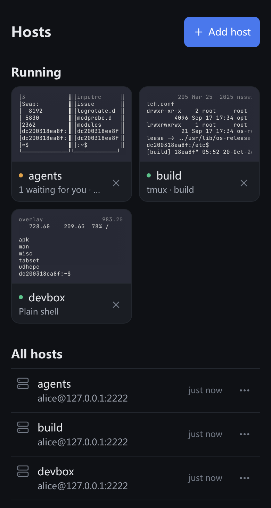
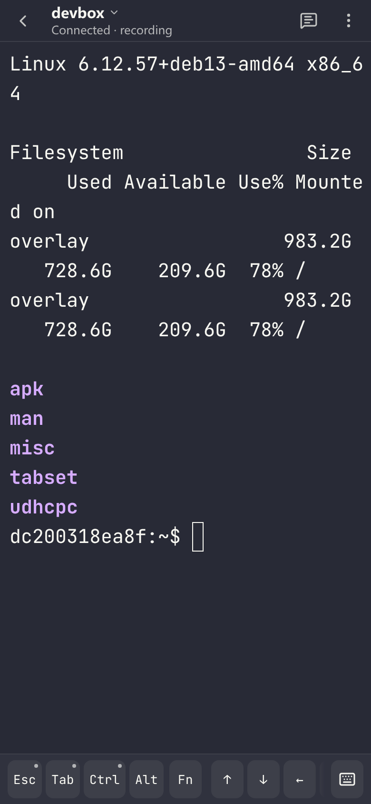
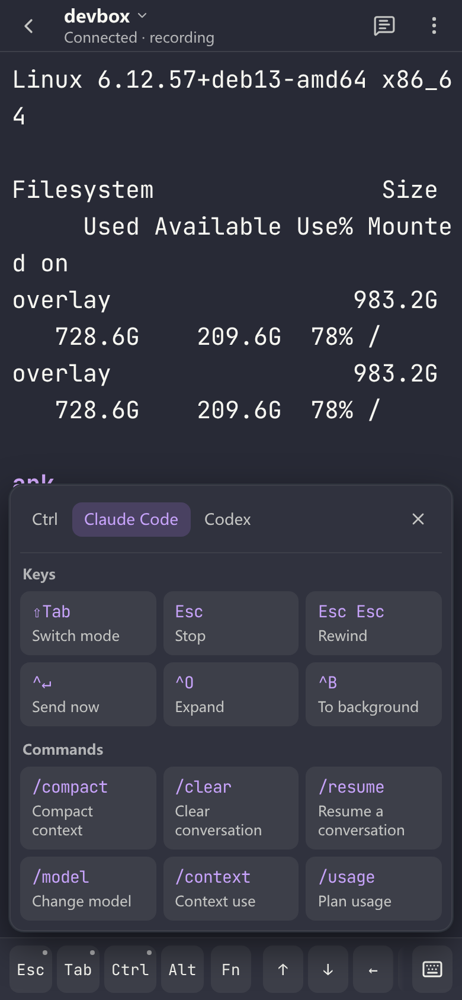
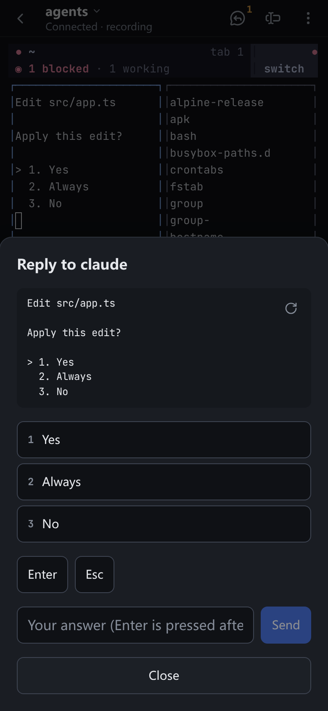
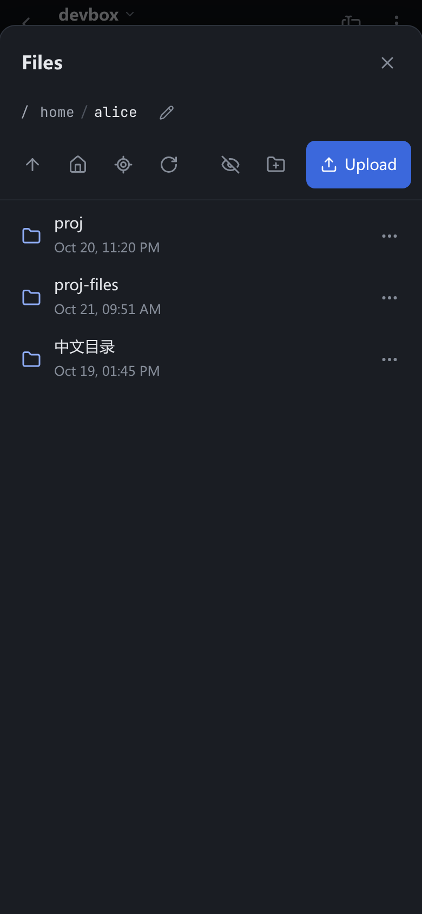
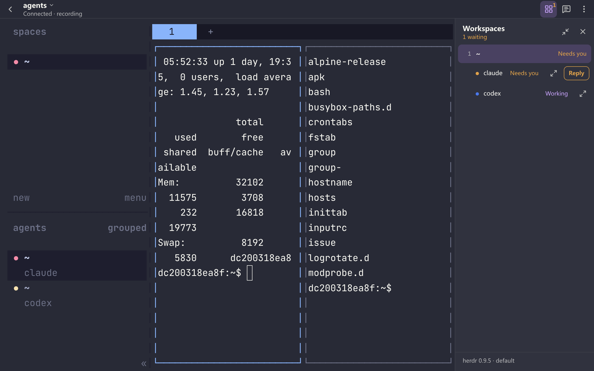
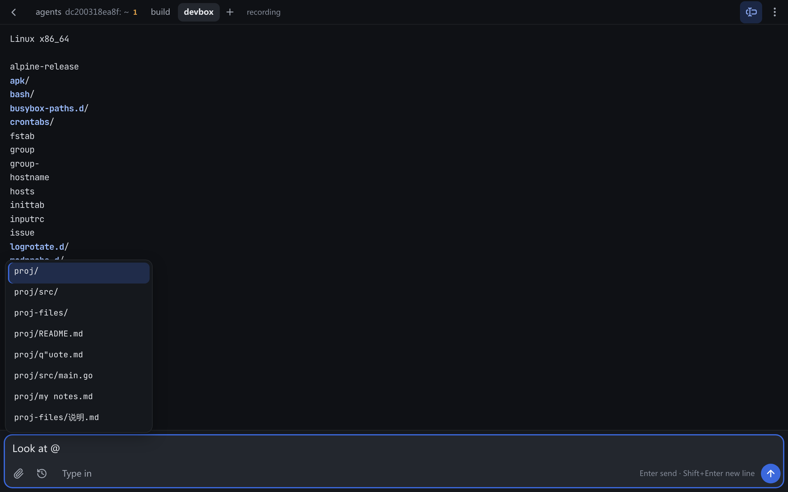

<p align="center">
  
</p>

<h1 align="center">Corral</h1>

A self-hosted web SSH client built for phones and tablets first, and for
running terminal coding agents (Claude Code, Codex, Gemini CLI…) from anywhere.

Corral is a gateway: it holds the SSH connections and serves a terminal to
the browser. Your phone can sleep, lose signal or switch apps; the session
keeps running and you pick it up where it was — on the same device or another.

<p align="center">
  
  
  
</p>
<p align="center">
  
  
</p>
<p align="center">
  
</p>
<p align="center">
  
</p>

## Features

**A terminal that works on a phone**
- The gateway keeps sessions alive while nobody looks; with tmux or
  [herdr](https://herdr.dev) on the host they also survive gateway
  restarts, and the open pages reattach them by themselves after one (an
  update) or after the connection to the host dropped. Opening a host lists
  its tmux and herdr sessions to pick from, along with a new tmux session
  and a plain shell.
- The home page shows your running sessions as cards with their screen in
  small, as one of your windows last showed it; the hosts below open new
  ones.
- A key bar with Esc, Ctrl and Alt (tap once or lock), Tab and Shift+Tab,
  arrows, F1–F12 and the symbols that are hard to type on a phone keyboard,
  arranged as you like: which keys stay on the left, which scroll, in what
  order, which are hidden. Add keys of your own that send a sequence,
  written as for tmux's send-keys (`C-b c`, `"git status" Enter`) or as in
  Moshi (`C-b, S-t`, `text:/clear, Enter`), or picked from a list with a
  preview in words; most keys can send another sequence on a long press.
  It all follows you to every device.
- A long press on Ctrl opens a shortcut panel: Ctrl combinations, herdr's
  tabs, splits and panes, tmux's prefix keys, and Claude Code's and Codex's
  commands, opening on the page of the agent you are looking at.
- Tapping the terminal reaches the program (herdr's sidebar, mouse modes)
  without bringing up the on-screen keyboard; tapping where you type — the
  cursor's line, Claude Code's input box — or the keyboard button does. A
  hardware keyboard types at once.
- Input methods work: Chinese and other IMEs, dictation, and a composer field
  for writing longer input before sending it. On a computer Enter sends and
  Shift+Enter starts a new line, as in the agents' own input boxes (a
  setting swaps them). It keeps its draft (across a reload of the tab) and
  what you sent (Up, or its history button), shows a long paste as a label
  it sends in full, offers Claude Code's suggested next prompt (Tab), and
  completes as the agents' own input boxes do: `@` and a file under the
  folder the terminal is in, `/` and a command (built in, or your own in
  `.claude/commands`, skills, Codex prompts), `$` and a Codex skill.
- On a desktop or a tablet, every running session is a tab, kept connected so switching
  is instant; `+` opens another. A tab shows how many agents wait for you,
  or finished and were not looked at yet. Ctrl+Tab and Ctrl+Shift+Tab go to
  the next and previous one in the installed app (a browser keeps those keys
  for its own tabs); on a touch screen, two fingers swiped sideways go to
  the next session, up or down to herdr's next workspace.
- Several devices can have one session open; the one you act on decides the
  terminal size, the others follow it. A window opened long after a program
  started still gets the modes it set (mouse reporting, bracketed paste…).
- After an upgrade, open pages offer to reload into the new version.
- A copy mode with native text selection, colour schemes (one for a light
  and one for a dark appearance, if you like), adjustable fonts, installable
  as an app (PWA). Programs that follow the terminal's colours are told when
  it turns light or dark (mode 2031): Claude Code with its theme set to
  "Auto (match terminal)", herdr with `auto_switch = true` under `[theme]`
  in its config.
- Programs on the host can copy to your device's clipboard (OSC 52): tmux's
  copy mode, Claude Code, editors. Where the browser allows that only on a
  tap (Safari), Corral offers a button. Inside tmux, programs that send OSC 52
  themselves (vim, Neovim) also need `set -g set-clipboard on`.

**Made for coding agents**
- Paste, drop or pick an image: it is uploaded to the host and its path is
  typed into the terminal, which is how Claude Code and Codex take images
  (Ctrl+V works as in a local terminal); when Gemini CLI is in front (in a
  tmux or herdr session), the path is typed as `@path`, which is how it
  takes them. Shift+Enter inserts a newline, and Ctrl+Enter reaches the
  programs that tell it apart (Claude Code's "send now").
- Answer an agent that waits in herdr without switching to it — from the
  top bar's button, shown with how many wait (herdr's own sidebar lists
  every workspace and agent), or straight from its notification: you see
  its screen, tap one of its choices, Enter or Esc, or type a line. Nothing
  is typed if the screen changed in the meantime.
- Push notifications (and optional webhooks) when an agent in herdr needs
  you or finishes, or when a program rings the terminal bell or sends a
  desktop notification (OSC 9 / OSC 777) — unless you are looking at that
  session anyway. An agent's alert says what it asks; where the platform
  shows buttons (not iOS), its first and last choices answer it from the
  alert, once, if nothing changed since. Tapping it opens the session on
  that agent's pane (herdr switches to its workspace). Once the agent no
  longer waits, its alert is replaced. At most 10 alerts a minute. The
  terminal offers to turn alerts on once agents show up.

**Around the terminal**
- A file panel: browse the host, upload (with progress, asking before
  replacing), download, create folders, rename, delete, and insert a path
  into the terminal — starting in the terminal's current folder.
- Open web servers running on the host (dev servers, previews) in the
  browser through port forwarding, privately or shared with other users.
- Open the host in VS Code in the browser ([code-server](https://github.com/coder/code-server),
  installed on the host on demand; not bundled with Corral). With the
  Chinese interface it opens in Chinese too: the VS Code language pack is
  fetched from [Open VSX](https://open-vsx.org) by the host, or uploaded from
  `CORRAL_CODE_SERVER_DIR`, and checked against a pinned digest.

**Several users**
- Accounts by invitation, or created directly by an administrator with a
  first password to hand over; administrators and members, each with their
  own hosts and keys. A password an administrator set (a new account, a
  reset) must be changed at the next sign-in before anything else. SSH
  passwords and keys are encrypted at rest and never sent to the browser.
- Hosts behind another host are reached through it (a jump host, one level):
  any of your hosts with a saved password or key.
- Two-step sign-in with an authenticator app, with recovery codes.
- An audit log of sign-ins, connections, file changes and administration.
- Optional session recording (asciicast, played back in the browser) and
  read-only watching of a session the owner shares.
- The gateway connects only to networks you allow (private ranges by
  default), checked after DNS resolution.

Chinese and English user interfaces ship together.

## Run

Corral is one binary (or container image) with an embedded web interface and
a SQLite database. Images for linux/amd64 and linux/arm64 are published as
`ghcr.io/ihainan/corral` (`latest`, or a version such as `0.1.0`); the
[releases](https://github.com/ihainan/corral/releases) also have Linux
binaries. It needs a public URL and a master key:

```sh
docker run -d --name corral -p 127.0.0.1:8080:8080 -v corral-data:/data \
  -e CORRAL_PUBLIC_URL=https://ssh.example.com \
  -e CORRAL_MASTER_KEY="$(docker run --rm ghcr.io/ihainan/corral genkey)" \
  ghcr.io/ihainan/corral
docker logs corral   # prints a one-time link for creating the first administrator
```

To build the image yourself: `docker build -t corral .` (any platform, e.g.
`docker buildx build --platform linux/arm64`).

Or with Compose, keeping the key in a file outside the data directory:

```yaml
services:
  corral:
    image: ghcr.io/ihainan/corral:0.1.0
    restart: unless-stopped
    ports: ["127.0.0.1:8080:8080"]
    environment:
      CORRAL_PUBLIC_URL: https://ssh.example.com
      CORRAL_MASTER_KEY_FILE: /run/secrets/corral-master-key
      CORRAL_TRUSTED_PROXIES: 172.16.0.0/12   # the reverse proxy, as the container sees it
    volumes:
      - ./data:/data
      - ./master.key:/run/secrets/corral-master-key:ro
```

Open the link from the log to create the first administrator, then invite
everyone else from **Users**.

### Behind a reverse proxy

Serve Corral over HTTPS. The proxy must pass WebSocket upgrades, must not
buffer responses, and should allow long-lived connections and uploads as
large as `CORRAL_UPLOAD_MAX_MB`; see [`deploy/nginx.conf.example`](deploy/nginx.conf.example).
Set `CORRAL_TRUSTED_PROXIES` to the proxy's address so sign-in limits and the
audit log see real client addresses.

### Forwarded ports and VS Code

Both are served on subdomains of `CORRAL_FORWARD_DOMAIN`: `<port>-<id>.<domain>`
for a forwarded port and `code-<id>.<domain>` for VS Code. Point a wildcard DNS
record (`*.<domain>`) and a wildcard certificate at the proxy, and route those
names to Corral as well. Each forward is checked against the signed-in user
on every request; subdomains cannot read the main site's sign-in.

### On the hosts

Nothing needs to be installed. With **tmux** or **herdr** on a host, opening
it offers their sessions (and a new tmux session); terminals running in them
survive the gateway restarting and can be attached from elsewhere. A host
with neither opens a plain shell. The file panel and image uploads need the
host's SFTP subsystem (enabled by default in OpenSSH).

## Configuration

All settings are environment variables.

| Variable | Default | Meaning |
|---|---|---|
| `CORRAL_PUBLIC_URL` | (required) | The URL users open; used for origin checks and cookies |
| `CORRAL_MASTER_KEY` / `CORRAL_MASTER_KEY_FILE` | (required) | 32 random bytes, base64 (`corral genkey`); encrypts stored credentials |
| `CORRAL_LISTEN` | `127.0.0.1:8080` (`0.0.0.0:8080` in the image) | Listen address |
| `CORRAL_DATA_DIR` | `./data` (`/data` in the image) | Database and recordings |
| `CORRAL_ALLOWED_NETWORKS` | private ranges | Networks SSH targets may resolve to |
| `CORRAL_DENIED_NETWORKS` | — | Extra networks to refuse (link-local, multicast and unspecified are always refused) |
| `CORRAL_TRUSTED_PROXIES` | — | Proxies whose `X-Forwarded-For` is believed |
| `CORRAL_DETACH_TIMEOUT` | `24h` | How long a session runs with nobody viewing it |
| `CORRAL_MAX_SESSIONS_PER_USER` | `20` | Open sessions per user |
| `CORRAL_UPLOAD_MAX_MB` | `100` | Upload size limit |
| `CORRAL_LOGIN_IDLE_TIMEOUT` / `CORRAL_LOGIN_MAX_AGE` | `168h` / `720h` | Browser sign-in lifetime |
| `CORRAL_DEFAULT_LANGUAGE` | each browser's language | `zh-CN` or `en` for everyone who has not picked one (and for webhooks) |
| `CORRAL_FORWARD_DOMAIN` | — | Parent domain for forwarded ports and VS Code; needs an `https://` public URL |
| `CORRAL_CODE_SERVER` | `on` with a forward domain | `on` / `off`: VS Code in the browser |
| `CORRAL_CODE_SERVER_VERSION` | `4.138.0` | code-server release installed on hosts |
| `CORRAL_CODE_SERVER_URL` | GitHub release | Download URL template (https) with `{version}` and optionally `{arch}` (`amd64`, `arm64`) |
| `CORRAL_CODE_SERVER_SHA256` | built in for `4.138.0` | Trusted archive digests, `amd64=<sha256>,arm64=<sha256>`; required for other versions |
| `CORRAL_CODE_SERVER_DIR` | — | Gateway directory with `code-server-{version}-linux-{arch}.tar.gz` (and, for the Chinese interface, `MS-CEINTL.vscode-language-pack-zh-hans-1.131.0.vsix`), uploaded to hosts without internet access |
| `CORRAL_RECORDING` | `off` | `on` records the output of every session |
| `CORRAL_RECORDING_DAYS` | `30` | How long recordings are kept |
| `CORRAL_RECORDING_MAX_MB` | `200` | Size limit of one recording |
| `CORRAL_PUSH_HOSTS` | — | Extra push service host suffixes (besides Apple, Google, Mozilla, Microsoft) |
| `CORRAL_WEBHOOK_PREFIXES` | — (webhooks off) | URL prefixes users may send alert webhooks to |
| `CORRAL_STATIC_DIR` | — (embedded) | Serve the web interface from this directory instead (front-end development) |

## Security

- **Keep the master key and the database apart.** Stored SSH credentials are
  encrypted with the master key; anyone with both can decrypt them. Back up
  `CORRAL_DATA_DIR` and keep the key somewhere else (a secret store, or a file
  that is not in the backup).
- **The gateway acts with the users' SSH credentials.** Anyone who controls
  the gateway can reach every host its users can. Run it on a machine you trust
  as much as the hosts behind it, and keep `CORRAL_ALLOWED_NETWORKS` as narrow
  as your hosts allow.
- **Sign-in.** Passwords are hashed with Argon2id; failed attempts slow an
  account down and are limited per address. Two-step sign-in is per user, and
  administrators can reset it for a lost phone. Disabling an account (or an
  administrator resetting its password) ends all of its browser logins,
  terminals and forwards at once; changing your own password signs out your
  other browsers; signing out ends that browser's login. Terminals otherwise
  keep running until closed or detached for `CORRAL_DETACH_TIMEOUT`.
- **Recordings** contain whatever the screen showed (not what was typed), and
  are kept unencrypted in the data directory. Owners see their own,
  administrators everyone's; watching one is audited. Say so to your users
  when you turn recording on — the terminal tells them it is recorded.
- **Watching** shows the screen, recent output included, to the people the
  owner adds; they cannot type, resize or use anything else.
- **Jump hosts.** `CORRAL_ALLOWED_NETWORKS` applies to what the gateway
  connects to itself, the jump host included. The hop from a jump host to the
  host behind it starts on the jump host, where the user can log in anyway;
  only addresses that are never a host (link-local, multicast, unspecified)
  are refused there.

Report security problems privately, not in a public issue: see
[SECURITY.md](SECURITY.md).

## Known limitations

- Two devices typing into one session at the same time interleave, as with
  any shared terminal.
- In a folder where other users may rename entries (world-writable without
  the sticky bit), an upload's staging folder can be swapped by them between
  steps; such a folder lets them tamper with anything put there anyway.
- The file panel shows the first 5000 entries of a folder, in the host's
  order, and says when there are more.
- Answering an agent checks the pane's screen right before typing, but herdr
  cannot check and type in one step: an answer given on the host in that
  very moment is not seen.
- After a gateway restart, the tabs reattached by themselves are those
  opened in that window since it loaded; other sessions are opened again
  from `+` or the host list.
- Claude Code's suggested prompt is read off the screen (greyed text in its
  input box): another program drawing the same box would be offered too,
  though only typed into the composer, never sent.

## Develop

```sh
docker build -t corral-test-sshd test/sshd && docker run -d -p 127.0.0.1:2222:22 corral-test-sshd
make web && go run ./cmd/corral serve   # with the variables above
make check                              # Go tests (incl. the security suite), type check, notices
make notices                            # after changing dependencies
```

The test SSH server accepts `alice` / `alice-pass`. Third-party licences are
listed in [`web/public/THIRD-PARTY-NOTICES.txt`](web/public/THIRD-PARTY-NOTICES.txt),
which the web interface also serves. See [CONTRIBUTING.md](CONTRIBUTING.md)
before sending a change, and [CHANGELOG.md](CHANGELOG.md) for what changed
between versions.

## License

[Apache-2.0](LICENSE)
