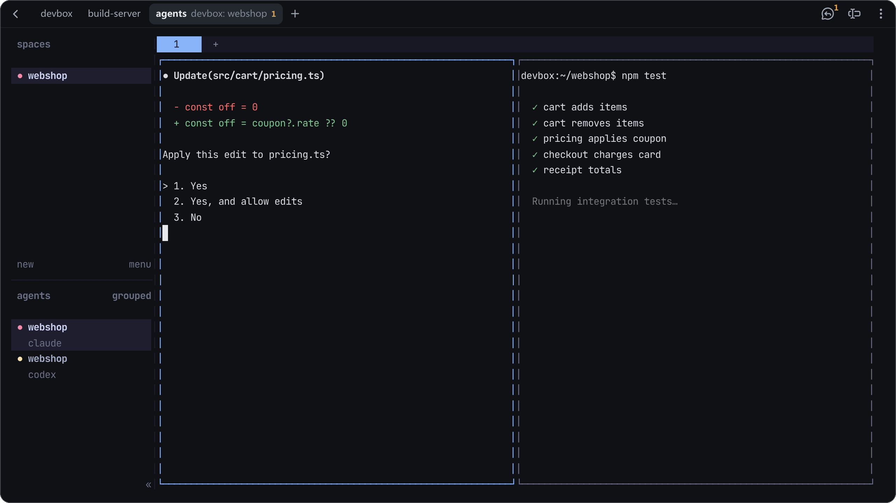
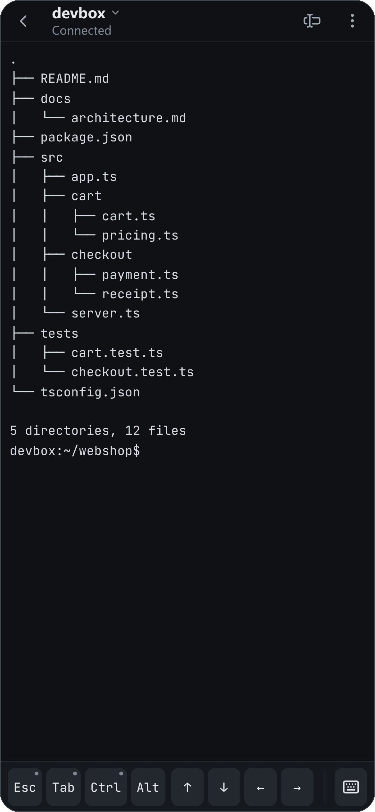
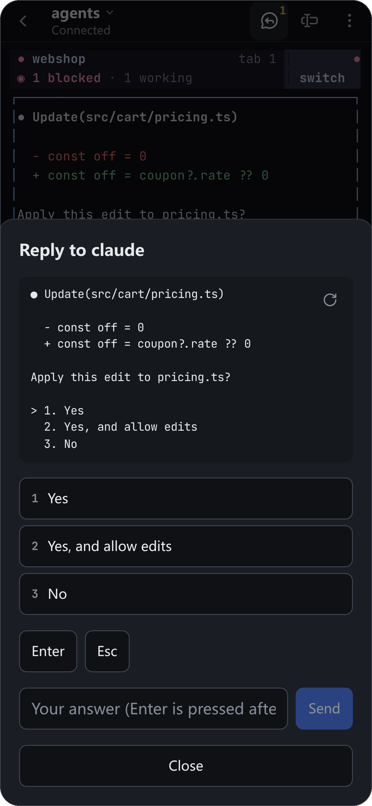
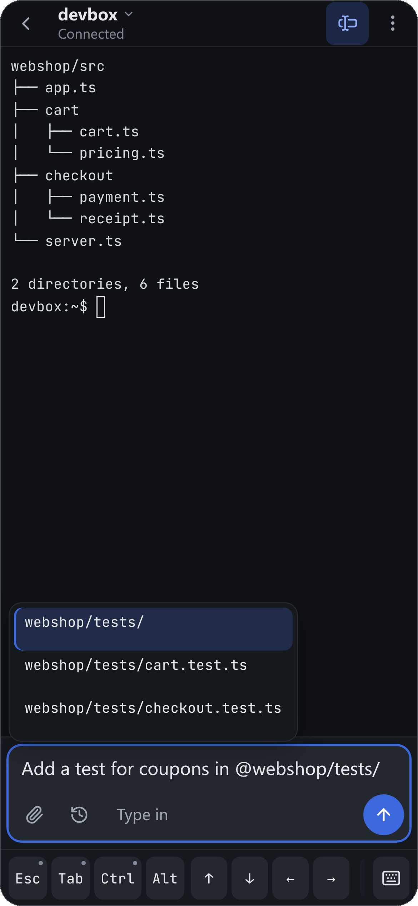

<p align="center">
  
</p>

<h1 align="center">Corral</h1>

<p align="center">
  A self-hosted SSH client in the browser, made for phones first<br>
  and for running coding agents — Claude Code, Codex, Gemini CLI — from anywhere.
</p>

<p align="center">
  <a href="#run">Run</a> ·
  <a href="#features">Features</a> ·
  <a href="#configuration">Configuration</a> ·
  <a href="#security">Security</a> ·
  <a href="#develop">Develop</a>
</p>

<p align="center">
  
</p>

<p align="center">
  
  
  
</p>

Corral is a gateway: it holds the SSH connections and serves the terminal to
the browser. Your phone can sleep, lose signal or switch apps — the session
keeps running, and you pick it up where it was, on the same device or another.

## Features

### A terminal that works on a phone

- **Sessions that wait for you** — They keep running while nobody looks. tmux
  and [herdr](https://herdr.dev) sessions also outlive a gateway restart, and
  open pages reattach them by themselves.
- **A key bar** — Esc, Ctrl, Alt, Tab, arrows, F1–F12 and hard-to-type symbols.
  Arrange it, add keys of your own, give keys a long press.
- **Typing** — Tap where you type for the keyboard; Chinese and other input
  methods and dictation work. A hardware keyboard types at once.
- **Gestures** — Two fingers sideways go to the next session, up or down to
  herdr's next workspace; pinch to size the font.

### Made for coding agents

- **Answer an agent** — When an agent in herdr waits, answer from the top bar or
  straight from its notification: its question, its choices as buttons.
- **Notifications** — When an agent waits or finishes, or a program rings the
  bell. Tapping one opens that agent's pane.
- **A composer** — Write longer prompts: `@` files, `/` commands, `$` skills,
  history, Claude Code's suggested prompt with Tab. Enter sends.
- **Images** — Paste, drop or pick one: it is uploaded to the host and its path
  typed in, as Claude Code and Codex take images.

### Around the terminal

- **Tabs** — On a desktop or tablet every session is a tab, with how many agents
  wait or are done. Ctrl+Tab in the installed app.
- **Files** — Browse the host, upload, download, rename, delete, insert a path.
- **Web previews** — Open servers running on the host through port forwarding;
  VS Code in the browser ([code-server](https://github.com/coder/code-server)).
- **Looks** — Colour schemes (one for light, one for dark), copy mode, clipboard
  from the host (OSC 52), installable as an app.

### For a team

- **Accounts** — By invitation or created by an administrator; each user has
  their own hosts and keys.
- **Safety** — Credentials encrypted at rest, two-step sign-in, an audit log,
  only the networks you allow.
- **Sharing** — Jump hosts, optional session recording, read-only watching of a
  session.

Chinese and English interfaces ship together.

<details>
<summary><b>More about the features</b></summary>

- Opening a host lists its tmux and herdr sessions to pick from, along with a
  new tmux session and a plain shell. The home page shows running sessions as
  cards with their screen in small.
- Keys of your own send a sequence written as for tmux's send-keys
  (`C-b c`, `"git status" Enter`) or as in Moshi (`C-b, S-t`,
  `text:/clear, Enter`), or picked from a list. A dot in a key's corner means
  it has a long press; a long press on Ctrl opens a shortcut panel (Ctrl
  combinations, herdr, tmux, Claude Code and Codex commands). The layout
  follows you to every device.
- The composer keeps its draft across a reload of the tab, shows a long paste
  as a label it sends in full, and completes as the agents' own input boxes do
  (`/` also offers your own commands in `.claude/commands`, skills, Codex
  prompts). On a computer Enter sends and Shift+Enter starts a new line; a
  setting swaps them.
- When Gemini CLI is in front (in tmux or herdr), an uploaded image's path is
  typed as `@path`. Shift+Enter inserts a newline and Ctrl+Enter reaches the
  programs that tell it apart (Claude Code's "send now").
- An agent's alert says what it asks; where the platform shows buttons (not
  iOS), its first and last choices answer it from the alert, once, if nothing
  changed since. Once the agent no longer waits, its alert is replaced. At
  most 10 alerts a minute; webhooks too, if enabled. The terminal offers to
  turn alerts on once agents show up.
- Several devices can have one session open; the one you act on decides the
  terminal size, the others follow it.
- Programs that follow the terminal's colours are told when it turns light or
  dark (mode 2031): Claude Code with its theme set to "Auto (match terminal)",
  herdr with `auto_switch = true` under `[theme]` in its config.
- Programs inside tmux that send OSC 52 themselves (vim, Neovim) also need
  `set -g set-clipboard on`. Where the browser allows copying only on a tap
  (Safari), Corral offers a button.
- VS Code opens in Chinese with the Chinese interface: the language pack is
  fetched from [Open VSX](https://open-vsx.org) by the host, or uploaded from
  `CORRAL_CODE_SERVER_DIR`, and checked against a pinned digest.
- A password an administrator set (a new account, a reset) must be changed at
  the next sign-in before anything else.

</details>

## Run

Corral is one binary or container image, with the web interface embedded and
a SQLite database. Images for linux/amd64 and linux/arm64 are published as
`ghcr.io/ihainan/corral`; the [releases](https://github.com/ihainan/corral/releases)
also have Linux binaries.

```sh
docker run -d --name corral -p 127.0.0.1:8080:8080 -v corral-data:/data \
  -e CORRAL_PUBLIC_URL=https://ssh.example.com \
  -e CORRAL_MASTER_KEY="$(docker run --rm ghcr.io/ihainan/corral genkey)" \
  ghcr.io/ihainan/corral
docker logs corral   # a one-time link to create the first administrator
```

Open the link from the log, create the first administrator, then add people
from **Users** (an invitation link, or an account you create).

<details>
<summary><b>With Compose</b></summary>

Keeping the key in a file outside the data directory:

```yaml
services:
  corral:
    image: ghcr.io/ihainan/corral:0.1.0
    restart: unless-stopped
    ports: ["127.0.0.1:8080:8080"]
    environment:
      CORRAL_PUBLIC_URL: https://ssh.example.com
      CORRAL_MASTER_KEY_FILE: /run/secrets/corral-master-key
      CORRAL_TRUSTED_PROXIES: 172.16.0.0/12   # the reverse proxy, as the container sees it
    volumes:
      - ./data:/data
      - ./master.key:/run/secrets/corral-master-key:ro
```

To build the image yourself: `docker build -t corral .` (any platform, e.g.
`docker buildx build --platform linux/arm64`).

</details>

<details>
<summary><b>Behind a reverse proxy</b></summary>

Serve Corral over HTTPS. The proxy must pass WebSocket upgrades, must not
buffer responses, and should allow long-lived connections and uploads as large
as `CORRAL_UPLOAD_MAX_MB`; see [`deploy/nginx.conf.example`](deploy/nginx.conf.example).
Set `CORRAL_TRUSTED_PROXIES` to the proxy's address so sign-in limits and the
audit log see real client addresses.

</details>

<details>
<summary><b>Forwarded ports and VS Code</b></summary>

Both are served on subdomains of `CORRAL_FORWARD_DOMAIN`: `<port>-<id>.<domain>`
for a forwarded port and `code-<id>.<domain>` for VS Code. Point a wildcard DNS
record (`*.<domain>`) and a wildcard certificate at the proxy, and route those
names to Corral as well. Each forward is checked against the signed-in user on
every request; subdomains cannot read the main site's sign-in.

</details>

<details>
<summary><b>On the hosts</b></summary>

Nothing needs to be installed. With **tmux** or **herdr** on a host, opening it
offers their sessions (and a new tmux session); terminals running in them
survive the gateway restarting and can be attached from elsewhere. A host with
neither opens a plain shell. The file panel and image uploads need the host's
SFTP subsystem (enabled by default in OpenSSH).

</details>

## Configuration

All settings are environment variables. Only the first two are required.

<details>
<summary><b>All variables</b></summary>

| Variable | Default | Meaning |
|---|---|---|
| `CORRAL_PUBLIC_URL` | (required) | The URL users open; used for origin checks and cookies |
| `CORRAL_MASTER_KEY` / `CORRAL_MASTER_KEY_FILE` | (required) | 32 random bytes, base64 (`corral genkey`); encrypts stored credentials |
| `CORRAL_LISTEN` | `127.0.0.1:8080` (`0.0.0.0:8080` in the image) | Listen address |
| `CORRAL_DATA_DIR` | `./data` (`/data` in the image) | Database and recordings |
| `CORRAL_ALLOWED_NETWORKS` | private ranges | Networks SSH targets may resolve to |
| `CORRAL_DENIED_NETWORKS` | — | Extra networks to refuse (link-local, multicast and unspecified are always refused) |
| `CORRAL_TRUSTED_PROXIES` | — | Proxies whose `X-Forwarded-For` is believed |
| `CORRAL_DETACH_TIMEOUT` | `24h` | How long a session runs with nobody viewing it |
| `CORRAL_MAX_SESSIONS_PER_USER` | `20` | Open sessions per user |
| `CORRAL_UPLOAD_MAX_MB` | `100` | Upload size limit |
| `CORRAL_LOGIN_IDLE_TIMEOUT` / `CORRAL_LOGIN_MAX_AGE` | `168h` / `720h` | Browser sign-in lifetime |
| `CORRAL_DEFAULT_LANGUAGE` | each browser's language | `zh-CN` or `en` for everyone who has not picked one (and for webhooks) |
| `CORRAL_FORWARD_DOMAIN` | — | Parent domain for forwarded ports and VS Code; needs an `https://` public URL |
| `CORRAL_CODE_SERVER` | `on` with a forward domain | `on` / `off`: VS Code in the browser |
| `CORRAL_CODE_SERVER_VERSION` | `4.138.0` | code-server release installed on hosts |
| `CORRAL_CODE_SERVER_URL` | GitHub release | Download URL template (https) with `{version}` and optionally `{arch}` (`amd64`, `arm64`) |
| `CORRAL_CODE_SERVER_SHA256` | built in for `4.138.0` | Trusted archive digests, `amd64=<sha256>,arm64=<sha256>`; required for other versions |
| `CORRAL_CODE_SERVER_DIR` | — | Gateway directory with `code-server-{version}-linux-{arch}.tar.gz` (and, for the Chinese interface, `MS-CEINTL.vscode-language-pack-zh-hans-1.131.0.vsix`), uploaded to hosts without internet access |
| `CORRAL_RECORDING` | `off` | `on` records the output of every session |
| `CORRAL_RECORDING_DAYS` | `30` | How long recordings are kept |
| `CORRAL_RECORDING_MAX_MB` | `200` | Size limit of one recording |
| `CORRAL_PUSH_HOSTS` | — | Extra push service host suffixes (besides Apple, Google, Mozilla, Microsoft) |
| `CORRAL_WEBHOOK_PREFIXES` | — (webhooks off) | URL prefixes users may send alert webhooks to |
| `CORRAL_STATIC_DIR` | — (embedded) | Serve the web interface from this directory instead (front-end development) |

</details>

## Security

- **Keep the master key and the database apart.** Stored SSH credentials are
  encrypted with the master key; anyone with both can decrypt them.
- **The gateway acts with the users' SSH credentials.** Run it on a machine you
  trust as much as the hosts behind it, and keep `CORRAL_ALLOWED_NETWORKS` as
  narrow as your hosts allow.
- **Tell your users when you turn recording on.** Recordings hold what the
  screen showed and are kept unencrypted in the data directory.

<details>
<summary><b>The details</b></summary>

- **Backups.** Back up `CORRAL_DATA_DIR` and keep the key somewhere else (a
  secret store, or a file that is not in the backup).
- **Sign-in.** Passwords are hashed with Argon2id; failed attempts slow an
  account down and are limited per address. Two-step sign-in is per user, and
  administrators can reset it for a lost phone. Disabling an account (or an
  administrator resetting its password) ends all of its browser logins,
  terminals and forwards at once; changing your own password signs out your
  other browsers; signing out ends that browser's login. Terminals otherwise
  keep running until closed or detached for `CORRAL_DETACH_TIMEOUT`.
- **Recordings** contain whatever the screen showed (not what was typed).
  Owners see their own, administrators everyone's; watching one is audited.
  The terminal tells users it is recorded.
- **Watching** shows the screen, recent output included, to the people the
  owner adds; they cannot type, resize or use anything else.
- **Jump hosts.** `CORRAL_ALLOWED_NETWORKS` applies to what the gateway
  connects to itself, the jump host included. The hop from a jump host to the
  host behind it starts on the jump host, where the user can log in anyway;
  only addresses that are never a host (link-local, multicast, unspecified)
  are refused there.

</details>

Report security problems privately, not in a public issue: see [SECURITY.md](SECURITY.md).

<details>
<summary><b>Known limitations</b></summary>

- Two devices typing into one session at the same time interleave, as with any
  shared terminal.
- In a plain shell `@` completes from the home folder (in tmux and herdr, from
  the folder the terminal is in).
- In a folder where other users may rename entries (world-writable without the
  sticky bit), an upload's staging folder can be swapped by them between steps;
  such a folder lets them tamper with anything put there anyway.
- The file panel shows the first 5000 entries of a folder, in the host's order,
  and says when there are more.
- Answering an agent checks the pane's screen right before typing, but herdr
  cannot check and type in one step: an answer given on the host in that very
  moment is not seen.
- After a gateway restart, the tabs reattached by themselves are those opened
  in that window since it loaded; others are opened again from `+` or the host
  list.
- Claude Code's suggested prompt is read off the screen (greyed text in its
  input box): another program drawing the same box would be offered too, though
  only typed into the composer, never sent.

</details>

## Develop

```sh
docker build -t corral-test-sshd test/sshd && docker run -d -p 127.0.0.1:2222:22 corral-test-sshd
make web && go run ./cmd/corral serve   # with the variables above
make check                              # Go tests (incl. the security suite), type check, notices
make notices                            # after changing dependencies
```

The test SSH server accepts `alice` / `alice-pass`. Third-party licences are
listed in [`web/public/THIRD-PARTY-NOTICES.txt`](web/public/THIRD-PARTY-NOTICES.txt),
which the web interface also serves. See [CONTRIBUTING.md](CONTRIBUTING.md)
before sending a change, and [CHANGELOG.md](CHANGELOG.md) for what changed
between versions.

## License

[Apache-2.0](LICENSE)
