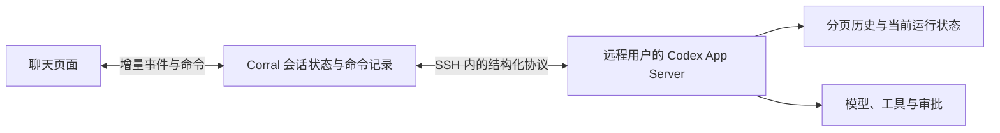

# Codex 聊天模式改进与验收方案

## 验收目标

聊天页显示、操作结果和 Codex 实际状态一致；操作失败时保留输入并提供恢复入口；性能有可复现的测量结果。测试结果绑定 Corral 代码版本、工作目录差异、Codex 版本、运行环境和原始证据。未执行、跳过、失败与通过分别记录。

## 测试层次

| 层次 | 验证内容 | 证据与限制 |
|---|---|---|
| 自动回归 | 日志解析、状态、发送保护、菜单解析、会话归属、越权与竞态 | 仓库内脱敏样本和断言；模拟进程不算真实 CLI |
| CLI 契约测试 | 真实 Codex 的终端画面、日志格式、工具结果、审批、会话切换 | 独立配置、目录、终端和本机模拟服务；不证明真实模型服务表现 |
| 浏览器联调 | 页面操作经网关、SSH 到终端及 CLI，核对最终日志与文件 | 同时验证页面状态；不能只检查 HTTP 200 或按钮可点击 |
| 性能测试 | 解析、首屏、增量更新、发送、审批、切换及资源消耗 | 区分冷启动与缓存，记录原始样本与分位数 |
| 设备与真实服务验收 | 真机输入法、软键盘、锁屏、通知；官方登录和中转 | 自动浏览器与模拟服务不能代替；需要独立环境和相应账号 |

## 功能矩阵

每项分别覆盖 herdr/tmux、独立进程/daemon、新会话/恢复会话。先固定一个 CLI 版本通过，再扩展兼容版本；无法提供的组合明确标记未执行。

| 功能 | 场景 | 通过条件 | 优先级 |
|---|---|---|---|
| 会话识别 | 同目录多进程、重启、切窗格、daemon、无日志新会话 | 绑定正确；未知状态拒绝发送；不会读取或操作另一会话 | P0 |
| 日志展示 | 新旧用户消息、代码模式/函数调用、工具结果、计划、错误 | 消息顺序正确、命令不重复、敏感输入不展示 | P0 |
| 发送与中断 | 中文、多行、连续空格、长粘贴、快速连发、工作中插话、Esc | 内容完整且只接收一次；中断结果与 CLI 一致 | P0 |
| 发送恢复 | 回车丢失、响应超时、发送中切换、刷新、重连 | 保留草稿；准确区分已接收与待确认；重试不重复 | P0 |
| 审批与提问 | 允许/拒绝、持久允许、文件审批、多题、自填、屏幕变化 | 显示操作对象；结果可从 CLI 日志和文件证实；过期选择不执行 | P0 |
| 图片 | 单图、多图、含空格路径、失败重试、历史回读 | CLI 收到图片类型；缩略图加载成功；文字与图片对应 | P1 |
| 模型与强度 | 列表、切换、忙碌、已有草稿、窄窗格、界面变化 | 下一轮实际采用所选值；不改变其他会话默认值 | P1 |
| 会话操作 | 压缩、新建、恢复、整份分叉 | 历史与绑定正确；原会话可继续；失败不残留半成品 | P1 |
| 回退 | 单轮、多轮、压缩后、分段日志、恢复后 | 保留的历史完整；回退内容不冒充当前上下文；未知格式不猜测 | P1 |
| 子代理与后台命令 | 并行、完成、失败、父会话恢复、打开详情 | 状态正确；结果归属正确；完成后释放占用 | P1 |
| 内容操作 | Markdown、文件链接、代码复制、搜索、历史导航、导出 | 内容完整；链接定位正确；折叠内容可检索 | P1 |
| 提醒与偏好 | 完成、需回答、多标签、静音、语言、主题、账号切换 | 不重复提醒、不跨账号残留；真机实际可听见/收到 | P2 |

## 性能矩阵

所有浏览器指标分别测空闲、工作中、等待审批，以及 1/10/30 个会话；日志使用约 1/4/40/200 MiB，额外覆盖 6000 条展示上限、大图片和长工具输出。解析微基准使用明确标记的合成数据，不能替代浏览器验收。

| 指标 | 采集方式 | 初始验收标准 |
|---|---|---|
| 日志解析 | Go benchmark，记录 ns/op、B/op、allocs/op、MB/s | 固定机器重复 5 次；与基线相比耗时/内存退化超过 20% 时调查，不跨机器硬比较 |
| 首屏与会话切换 | 点击至正确内容出现，冷/热各至少 30 次 | 局域网首屏 P95 ≤ 2 秒，缓存切换 P95 ≤ 200 ms；以实测校准 |
| 发送确认 | 点击至 CLI 日志出现消息；另测页面确认 | 分别报告 SSH/CLI 和页面轮询延迟；不把 HTTP 返回当接收 |
| 审批响应 | CLI 开始等待至卡片可操作；点击至结果生效 | P95 ≤ 3 秒；慢网单独报告 |
| 页面流畅度 | long task、输入延迟、滚动、DOM 数量 | 常用操作无超过 200 ms 的主线程任务；超限保留 trace |
| 持续资源 | 浏览器内存、网关 CPU/RSS、SSH exec 与传输字节 | 运行 2 小时；完成、关闭会话后资源回落；后台页面停止无用轮询 |
| 网络条件 | 本机、85/200 ms 延迟、限速、丢包、断开恢复 | 独立记录；无重复发送、草稿丢失或错误归属 |

## 设备与异常矩阵

- 自动浏览器：Chromium、Firefox、WebKit；桌面、平板、手机尺寸；中英文、深浅主题；窄终端与短终端。
- 真机：iPhone Safari、iPad Safari、Android Chrome；中文输入法候选确认、软键盘升降、横竖屏、安全区、选择复制、粘贴图片、触控目标、锁屏恢复。
- 异常：SSH 中断、网关重启、CLI 退出/升级、终端被其他程序占用、SFTP 失败、日志截断/替换、服务 429/5xx、超时、取消、账号退出和只读分享。
- 安全与并发：陈旧绑定、PID 重用、屏幕变化、双击、多标签并发、用户同时在终端输入、跨用户读写、日志中的控制字符与超长字段。

## 实施顺序

1. **测试基础**：关键样本随仓库保存；缺样本、准备失败、超时、零用例和必需用例跳过均失败；报告保留每个阶段的状态；CI 运行稳定回归。
2. **当前 CLI 契约**：用隔离目录和本机模拟服务测试已安装版本；核查日志与终端差异，再修改生产路径；新格式必须有正反例及回归。
3. **功能闭环**：会话归属、回退和图片优先；随后补审批、自填、模型菜单及故障恢复。按上表核对实际 CLI 结果。
4. **浏览器与性能**：建立可独立启动的 SSH/网关/CLI 夹具；补三引擎联调、测量分位数与资源；根据数据优化。
5. **发布验收**：在明确获准的环境完成真机、真实服务和长时间运行；核对构建产物版本与实际行为，再决定发布。

## 执行入口

```sh
make codex-check                         # 必需的 Codex 自动回归，失败状态不可被日志管道吞掉
make codex-bench                         # 合成 Codex 日志解析基准
python3 scripts/codex_contract.py --output /tmp/corral-codex-contract
python3 -B scripts/codex_browser.py --output /tmp/corral-codex-browser
python3 -B scripts/codex_bench_compare.py --output /tmp/corral-codex-bench
```

CLI 契约测试使用本机 `codex`、`tmux`、Go 和 Python 3.11+ 标准库；不读取个人 Codex 配置，不调用真实模型，不复用已有 tmux 会话。输出目录必须是新目录。测试失败也保留报告；清理仅作用于本次创建的终端和临时目录。

浏览器组件回归需要 `pip install -r test/browser/requirements.txt` 和 `python3 -m playwright install chromium firefox webkit`。运行时自行启动独立 Vite 服务，使用真实聊天组件和模拟接口，覆盖 36 组浏览器、尺寸、主题和语言组合；此层不算网关、SSH 与 CLI 的端到端联调。生产构建不包含测试页面。

性能对照通过 Go overlay 临时替换基线版本的 `internal/convo/codex.go`，不切分支、不改工作目录。两组使用相同基准、同一 CPU 并发数，各重复 5 次，保留原始输出和中位数。

历史外部测试可作为证据线索，不能直接迁入 CI 或原样重跑：旧脚本存在退出状态丢失、共享环境依赖和宽泛清理。新的浏览器夹具必须限定资源归属后再启用。

## 当前状态

本方案中的矩阵是验收要求，并非已完成清单。逐项结果以对应执行报告为准；真实手机、真实服务、完整浏览器矩阵和长时间运行未执行时，不能标为通过。

2026-11-12 已实施：关键模型选择器样本随仓库保存；必需回归入口及失败状态测试接入 CI；新增真实 CLI 契约入口及 Codex 解析性能基准。实测 Codex 0.167.2 回退会生成 `原会话号_分段号` 日志，首行仍保留原会话号：网关定位和主机发送保护现在使用原会话号，避免误认分段号；页面提示仅展示回退后的新增记录，未臆测或拼接此前保留的历史。旧格式的 `thread_rolled_back` 也会从轮次目录移除已回退消息，包括同轮插话。

模型菜单补充：0.167.2 使用可滚动列表和 `(current)` 标记。现在读取完整列表后才返回选项，按屏幕摘要核对每次移动；滚动未生效、列表变化或超过上限时拒绝返回部分列表。真实 CLI 测试直接调用 Corral 的模型选择流程，核对下一轮日志的模型与思考强度；`turn_context.effort` 和 `thread_settings.reasoning_effort` 会更新页面元数据，默认值不会继承旧的显式强度。

性能优化：超过保留上限的轮次索引清空淘汰项后移动起点，避免每新增一轮复制 1000 个指针。浏览器组件测试检查图片实际解码、文件链接菜单、回退历史提示更新和横向溢出，测试模拟数据与真实 CLI 证据分别记录。

仍需推进：回退前保留历史的可靠读取、独立 SSH/网关/真实 CLI 浏览器夹具、daemon/herdr 组合、完整性能矩阵、弱网和持续运行、真实手机及真实服务验收。

## daemon 会话识别故障

2026-11-12 部署后的用户截图证明，前述独立进程契约测试不能覆盖 daemon 与同目录多进程组合。两个实际 Codex 窗格运行正常，聊天页却返回 `not_told` 并禁止发送。只读实机排查发现：

- daemon 候选列表混入 `guardian_review` 等子代理日志，原来的六个候选上限会截掉主会话。
- 最近聊天消息可能距日志末尾数百 KiB，原来的 16 KiB 尾读只得到工具输出。
- 工作中的可见画面可能只剩工具调用摘要，依赖聊天文字结尾无法识别。
- daemon 模式的 `codex resume` 进程没有自己的日志 FD，原来的无日志分支会直接跳过它。

修复过滤子代理候选，支持 daemon 模式的恢复进程，并读取每份候选日志最后 4 MiB 中的短消息、工具调用和回退边界。每份日志最多回传 64 KiB；只把聊天文字和实际工具参数作为匹配证据，工具参数只与 CLI 绘制的顶层 `Ran`／`Running` 标题匹配，不以任意工具输出认领会话。最多核对 64 个主会话，超过上限或任何候选不可读时拒绝认领，避免对部分候选错误地宣称文字唯一。相同文字、相同命令、已回退内容、陈旧进程标识仍不能授权发送。

自动回归包含大量工具输出、工具摘要画面、共享文字与命令、回退证据失效、子代理过滤及候选超限。`TestCodexDaemonLiveBinding` 需要显式提供窗格与预期会话号，只读运行生产定位脚本、屏幕匹配和发送前身份检查，不发送消息、按键或重启 CLI；该检查不计入可移植 CI 回归。

首次通过的真实窗格检查：两个同目录 Codex 分别匹配到各自预期会话，匹配及身份检查约 0.6 秒/窗格，主机进程扫描约 3 秒。这是特定主机与当时状态的样本，不是首屏 P95，也不证明完整浏览器联调、真机、弱网和持续运行已通过。没有可靠可见证据的 daemon 会话仍会拒绝自动绑定。

## Codex 与 Claude Code 的体验对照

### 取证范围

2026-11-12 对已部署版本 `v0.2.0-codex-daemon-20261112-130115-55621f5d08cc` 进行对照。取证目录为本机 `corral-chat-audit.PcB71x`；`provenance.json` 记录源码指纹、部署版本及前端产物校验。测量使用独立内存数据库和回环 SSH 服务，执行生产会话读取代码，只读访问同一主机中各两个 Claude Code／Codex 真实进程、同一工作目录下的真实日志。Chromium 使用与线上字节一致的前端资源和隔离测试账号。没有创建生产登录、修改线上数据库或向现有终端发送输入。

每类代理包含 6 次清空读取状态后的冷请求、30 次无新增内容的缓存请求、10 次实际发送前身份检查；浏览器每个真实会话测一次。样本数不足以报告可靠的 P95，回环连接也不代表真实网络。两个 Codex 样本含正在执行的任务，Claude 样本空闲；历史内容和大小不同，因此结论限于本次适配路径，不用于比较模型推理速度。

### 对照结果

| 指标 | Claude Code | Codex | 结论 |
|---|---:|---:|---|
| 冷会话接口，中位数 | 4466.6 ms | 4927.5 ms | 两者都慢，Codex 本组约慢 10% |
| 缓存接口、无新增内容，中位数 | 0.800 ms | 0.442 ms | 没有观察到 Codex 劣势 |
| 单次发送前身份检查，中位数 | 19.8 ms | 2379.9 ms | Codex 约为 120 倍；不包含发送、模型响应或网络等待 |
| Chromium 首屏，两个样本 | 5.54／7.07 s | 6.32／5.96 s | 均有明显等待，不能据此认定 Codex 渲染更慢 |
| Chromium 填写并清空草稿 | 81.8／51.1 ms | 58.8／34.9 ms | 本次未观察到 Codex 输入更慢 |

四个浏览器样本的最长主线程任务为 137 ms，无脚本错误。浏览器行数和历史内容不同，这不是相同数据量的渲染基准，也不替代真机输入法和长期性能测试。

逐阶段测量显示，共用进程定位的中位数为 4300.9 ms；Codex 额外候选尾读的中位数为 472.6 ms，回传约 1.90 MB。Claude 的冷请求也会扫描 Codex daemon 持有的日志，产生跨代理的性能影响。扫描缓存按 Corral 连接区分，同一主机的多个连接可能重复工作；发送路径还会独立重新扫描，并多次执行身份检查。上述身份检查耗时不能直接当作完整发送耗时，但足以证明 Codex 的发送准备存在严重额外开销。

原生协议也进行了实际验证：

| 原型 | 实测结果 | 限制 |
|---|---|---|
| 当前 daemon 的 `thread/read` | 12 次，中位数 3.26 ms；返回正确线程号和运行状态 | 本机 Unix 长连接读取，尚未接入 Corral |
| 当前 daemon 的历史分页 | 两个线程的轮次／内容分页均成功，约 2.6–13.2 ms | 样本和页大小有限；未恢复或修改现有线程 |
| 当前 daemon 的 `model/list` | 返回 23 项，约 2.25 ms | 目录可读不代表每个模型均有实际调用权限 |
| 独立 0.167.2 引擎的流式事件 | 21 个增量；首段 71 ms，完整日志消息约 1342 ms 才出现 | 使用延迟返回的本机模拟模型，不是模型服务速度测试 |
| 独立引擎的 `thread/settings/update` | 约 1.77 ms；仅目标线程变为 low，另一线程仍为 high，配置文件未改变 | 未修改生产线程；其他设置和多客户端控制权仍需验证 |

运行环境另有版本不一致：CLI 为 0.167.2，托管软件目录为 0.166.0，实际运行 daemon 为 0.164.0。接口能力必须以运行中的引擎为准，不能只依据 CLI 的版本或它生成的 schema。

结论：Codex 的会话归属、发送准备、实时显示和部分功能入口确实受到当前适配方式限制；“所有环节都明显比 Claude Code 慢”未被证实。上一轮扩大候选及尾读范围解决了部分识别失败，仍依赖终端文字、全机扫描和日志落盘，不能视为根本解决。

## Codex 原生接入方案

### 架构目标

Codex Chat Mode 改为使用 Codex 自身 App Server 的结构化协议：以明确的 `threadId` 定位会话，通过 RPC 操作，通过事件流同步状态和增量文本。复用远程用户现有的模型供应商、登录、插件、沙箱及审批配置。协议客户端通过已有 SSH 连接访问远程 Unix 控制通道；每个远程用户复用常驻引擎，页面和网关重连不应导致正在执行的任务随之终止。

连接、命令和共享状态仍受 Corral 账号及其主机凭据约束。同一账号的多个标签可以复用状态，不能仅因 SSH 用户名相同就跨账号共享数据。后端核验会话身份、控制能力和目标轮次，不信任页面直接提交的任意线程号，也不改变引擎现有的审批和沙箱策略。



终端身份推断和日志解析保留为旧会话的兼容路径；原生路径的读取、发送、审批和模型设置不再依赖 `/proc` 全扫描、候选日志比对、菜单截图或模拟按键。现有 Claude 适配可继续使用公共消息结构，共用定位扫描的影响应另行消除。

官方依据：[Codex App Server](https://learn.chatgpt.com/docs/app-server) 的线程、分页、事件、轮次和审批接口。当前本机控制通道实际使用 WebSocket 握手及帧；`app-server proxy` 只是字节转发，不会将其转换为逐行 JSON。远程传输与实验接口需锁定已验证版本，并在适配层协商能力。

### 改造内容

| 层次 | 实施内容 | 验收依据 |
|---|---|---|
| 原生协议客户端 | 新增独立 Codex 协议模块；管理长连接、请求关联、服务端请求、取消、断线及有界缓冲 | 多线程消息不串流；断线不自动重发未知结果的命令 |
| 会话身份 | 保存远程主机、SSH 用户、Codex 配置目录、引擎实例及 `threadId`；启动时直接记录 RPC 返回的身份 | 同目录、重命名、新建、恢复及网关重启后不靠文本猜测 |
| 历史与状态 | `thread/read` 读取状态，分页读取轮次／内容；原生事件更新同一份会话状态 | 多个页面共享读取状态；首屏只载入所需页，工具详情按需读取 |
| 消息与中断 | 使用 `turn/start`、带目标轮次约束的 `turn/steer`、队列和中断接口；保留草稿和命令结果状态 | 按原生接收结果确认；超时先对账，不盲目重复发送 |
| 审批与提问 | 直接呈现带 `threadId`／`turnId`／`requestId` 的服务端请求，响应后等待解决事件 | 过期问题不可答；终端与页面不会重复答复或互相夺取审批 |
| 模型与思考强度 | `model/list` 与线程设置接口；明确当前生效值和下一轮值 | 仅改变目标会话；不修改全局配置，不操作终端菜单 |
| 前端能力 | 用明确的能力字段取代 `!notClaude` 等判断；支持的操作按能力开放 | Codex 的强度、状态等入口与引擎实际能力一致 |
| 页面更新 | 快照加事件流；短周期合并文本增量，只更新变化的消息，保留滚动位置 | 已开始输出的文字无需等待完整消息写入 JSONL |
| 版本与诊断 | 分别记录 CLI、软件目录及运行引擎版本；启动时核对协议能力 | 不兼容时明确降级，不将 CLI schema 当作服务端能力证明 |

命令记录需要区分“发送中、引擎已接受、已完成、结果未知”。本次没有证明原生协议提供跨连接幂等键或完整事件重放，因此设计不能假定其存在。重连先读取当前轮次、历史和待处理请求进行对账，再恢复订阅；结果仍未知的发送不能自动重试。

### 现有会话的迁移边界

仅增加 App Server 客户端仍不足以解决现有窗格的归属。由 Corral 创建的会话可直接保存线程号；外部 CLI 窗格必须通过启动集成或明确登记取得稳定的线程号，并绑定到对应 pane。持久化以前猜到的会话号，不能替代身份来源。

运行中的外部会话先使用原生元数据和分页读取，不自动调用 `thread/resume` 或变更控制权。空闲会话逐项接入，保留原线程号，核对历史、模型、权限和后台工作后才启用原生控制。必须先在隔离环境验证两个客户端同时连接、审批请求路由、控制权转移及退出行为；不能假设 TUI 与网页同时控制天然安全。无法取得稳定身份或确认控制权的旧窗格继续使用兼容入口。

版本治理也按空闲迁移执行：固定并核对 CLI／daemon 的实际版本，保留已验证软件和配置，经过新引擎契约测试后逐步切换。测试和方案制定期间不重启现有 daemon，不中断用户任务。

### 实施阶段

1. **原型验证**：原生读取、历史分页、事件增量、会话内设置已完成本轮验证。尚未完成生产接入、实际消息发送、审批路由、控制权转移或故障恢复验收。
2. **只读接入**：增加原生读取和分页入口，建立共享会话状态，保留旧接口对照；记录扫描次数、读取字节及首屏耗时，核实原生路径不再扫描候选。
3. **托管会话交互**：先在隔离环境完成发送、中断、工作中插话、队列、审批、图片、模型和强度设置，再对新建托管会话灰度开放。能力和权限不得静默放宽。
4. **旧会话迁移**：完成双客户端和恢复测试，逐项接入空闲会话；核对稳定身份及控制权，保留回退入口。
5. **体验验收**：同机同负载测 1／10／30 个会话，冷／热各至少 30 次；覆盖弱网、重连、两个客户端、真机与两小时持续运行，结果绑定实际部署产物。

### 验收目标

| 项目 | 目标 |
|---|---|
| 局域网冷首屏 | P95 ≤ 1 秒；包含绑定、历史读取与页面可操作 |
| 缓存切换 | P95 ≤ 200 ms；内容和身份同时正确 |
| 发送接收确认 | P95 ≤ 200 ms；测引擎接受，不混入模型思考耗时 |
| 增量显示 | 原生事件到达网关至页面显示，P95 ≤ 100 ms |
| 模型／强度设置 | P95 ≤ 300 ms；核对会话值和全局配置隔离 |
| 原生路径开销 | 每次发送的全机扫描数为 0，候选日志回传字节为 0 |
| 并发和恢复 | 无串会话、重复消息、丢失草稿或陈旧审批；重连后状态一致 |

以上是改造后的验收要求，并非本轮已经达到的结果。本轮只完成了问题取证和原生能力原型；产品代码及线上部署未因本节方案发生变更。
